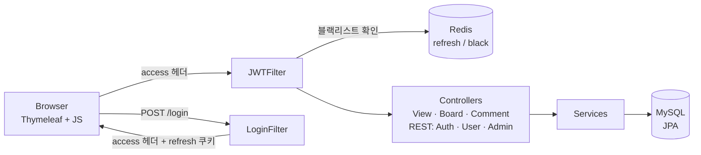
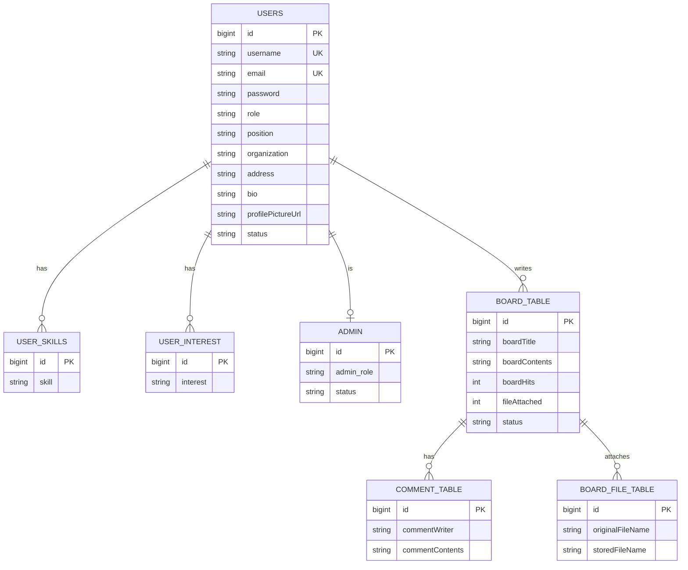

# StudyLink

> *Join the best projects in the world — Explore, Create, and Inspire with StudyLink*

함께 공부하고 프로젝트를 할 사람들을 연결하는 커뮤니티 웹 서비스입니다.
회원은 직무·소속·관심 분야·기술 스택으로 프로필을 만들고, 게시판에서 글과 댓글로 소통합니다. 관리자는 회원과 게시글, 관리자 권한을 관리합니다.

- 기간: 2024.07.29 ~ 2024.08.24 (약 4주, 4인 팀 프로젝트)
- 원본 저장소: [choiyounghwan123/study-link](https://github.com/choiyounghwan123/study-link)


---

## Features

| 영역 | 기능 |
| --- | --- |
| 인증 | 회원가입, JSON 로그인, Access / Refresh Token 발급과 재발급, 로그아웃 시 Access Token 블랙리스트 |
| 마이페이지 | 프로필 조회·수정(직무, 소속, 주소, 소개, 프로필 사진), 비밀번호 변경, 회원 탈퇴 |
| 관심 분야·기술 스택 | 관심 분야와 기술 스택 추가·삭제 |
| 게시판 | 글 작성·수정·삭제, 조회수, 페이징, 댓글, 첨부 파일 |
| 관리자 | 회원·게시글·관리자 목록, 회원 권한 변경, 관리자 권한 부여·회수, 최고 관리자 / 일반 관리자 화면 분리 |
| 에러 페이지 | 401, 403, 404 전용 페이지 |

---

## Architecture



### 인증 흐름

1. `POST /login`으로 JSON(아이디, 비밀번호)을 보내면 `LoginFilter`가 인증한 뒤 **Access Token은 `access` 응답 헤더**, **Refresh Token은 `refresh` 쿠키**로 내려줍니다.
2. 이후 요청은 `access` 헤더에 토큰을 담아 보내고, `JWTFilter`가 서명과 만료를 검증해 인증 정보를 등록합니다. 세션은 쓰지 않습니다(`STATELESS`).
3. Access Token이 만료되면 `POST /api/auth/reissue`로 Refresh Token을 이용해 새 토큰을 받습니다. Refresh Token은 Redis에 TTL과 함께 저장됩니다.
4. 로그아웃하면 Refresh Token을 지우고, Access Token은 남은 유효 시간 동안 Redis 블랙리스트에 올려 재사용을 막습니다.
5. 권한은 `USER`, `ADMIN`이며 `/api/user/**`는 USER, `/api/admin/**`는 ADMIN만 접근할 수 있습니다.

---

## Data Model



Redis에는 `refresh`(Refresh Token)와 `black`(로그아웃된 Access Token) 두 종류의 데이터를 TTL과 함께 저장합니다.

---

## API

### REST

| Method | Path | 설명 | 권한 |
| --- | --- | --- | --- |
| POST | `/login` | 로그인, 토큰 발급 | 모두 |
| POST | `/logout` | 로그아웃, 토큰 무효화 | 로그인 |
| POST | `/api/auth/register` | 회원가입 | 모두 |
| POST | `/api/auth/reissue` | Access Token 재발급 | 모두 |
| POST | `/api/auth/validate-token` | 토큰 검증 | USER |
| POST | `/api/auth/check-role` | 현재 사용자 권한 확인 | 모두 |
| GET | `/api/user/profile` | 내 프로필 조회 | USER |
| PUT | `/api/user/update-profile` | 프로필 수정 | USER |
| PUT | `/api/user/password` | 비밀번호 변경 | USER |
| DELETE | `/api/user/delete-user` | 회원 탈퇴 | USER |
| GET / DELETE | `/api/user/skills`, `/api/user/delete-skill` | 기술 스택 조회·삭제 | USER |
| GET / POST / DELETE | `/api/user/interests`, `/api/user/add-interest`, `/api/user/delete-interest` | 관심 분야 조회·추가·삭제 | USER |
| GET | `/api/admin/member`, `/api/admin/board`, `/api/admin/admin` | 회원·게시글·관리자 목록 | ADMIN |
| PUT | `/api/admin/member/{userId}` | 회원 권한 변경 | ADMIN |
| POST / DELETE | `/api/admin/{userId}/add-admin`, `/api/admin/{userId}/remove-admin` | 관리자 권한 부여·회수 | ADMIN |

### 화면 (Thymeleaf)

| 경로 | 화면 |
| --- | --- |
| `/index`, `/board/index` | 메인 |
| `/login`, `/register` | 로그인, 회원가입 |
| `/mypage`, `/profile`, `/mypage/password-change`, `/mypage/delete-account` | 마이페이지, 프로필, 비밀번호 변경, 탈퇴 |
| `/board/`, `/board/paging`, `/board/{id}`, `/board/save`, `/board/update/{id}` | 게시판 목록·상세·작성·수정 |
| `/admin/**` | 관리자 화면 (회원, 게시글, 관리자, 최고·일반 관리자) |
| `/401`, `/403`, `/404` | 에러 페이지 |

---

## Project Structure

```text
src/main/java/com/project/project/
├── config/        # SecurityConfig(필터 체인, 권한), RedisConfig, WebConfig(업로드 경로), AdminConfig
├── controller/    # View, Board, Comment (화면) / Auth, User, UserInterest, Admin (REST)
├── dto/           # 요청·응답 DTO (userServiceDto, Admin_user 하위 패키지)
├── entity/        # User, Admin, BoardEntity, CommentEntity, BoardFileEntity, UserSkill, UserInterest
│                  # Redis: UserRefreshToken, BlackList
├── exception/     # GlobalExceptionHandler, 사용자·토큰 예외
├── repository/    # JPA / Redis Repository
├── response/      # 공통 응답 형식
├── service/       # 회원, 게시판, 댓글, 관리자, JWT 토큰, 로그아웃
└── util/          # JWTUtil, JWTFilter, LoginFilter, 인증 실패·권한 없음 핸들러
src/main/resources/
├── templates/     # user, board, Admin, error 화면
└── static/        # css, js(페이지별 fetch 로직), images
```

---

## Getting Started

### 1. 환경변수

DB 접속 정보와 JWT 비밀키는 코드에 넣지 않고 환경변수로 받습니다.

```bash
cp .env.example .env   # SPRING_DATASOURCE_PASSWORD, JWT_SECRET 등 채우기
```

### 2. 실행

```bash
# Docker Compose (앱만 실행, MySQL·Redis는 별도 준비)
docker compose up --build        # http://localhost:8081

# 또는 로컬 실행 (Java 17, MySQL 8, Redis localhost:6379 필요)
set -a; source .env; set +a      # .env 값을 환경변수로 불러오기
./gradlew bootRun                # http://localhost:8080
```

게시판 첨부 파일은 `WebConfig`의 `savePath`(기본값 `C:/springboot_img/`)에 저장되므로, 실행 환경에 맞게 경로를 바꿔야 합니다.

---

## Team

| 이름 | GitHub | 커밋 수 |
| --- | --- | --- |
| 최영환 | [@choiyounghwan123](https://github.com/choiyounghwan123) | 60 |
| - | [@bibisam06](https://github.com/bibisam06) | 96 |
| 고영훈 | [@YoungHoonKo](https://github.com/YoungHoonKo) | 53 |
| - | [@parkddangkong](https://github.com/parkddangkong) | 9 |

### 고영훈 담당 (커밋 기록 기준)

- **프론트엔드 화면:** 메인(index), 마이페이지, 프로필, 로그인·회원가입, 비밀번호 변경·회원 탈퇴 페이지의 레이아웃과 스타일
- **게시판 디자인:** 목록·상세·작성·수정·페이징 화면 스타일, 배경 이미지
- **에러 페이지:** 401·403·404 페이지 추가와 연결, 파비콘 경로 정리
- **화면 연결:** 마이페이지·프로필·About 페이지 연결, 관심 분야·기술 스택 입력 UI, `ViewController`와 `SecurityConfig`의 페이지 경로 설정

---

## Known Issues

- `/start` 경로는 아직 `start` 템플릿을 반환하지만, 해당 템플릿 파일(`start.html`)은 삭제된 상태입니다.
- 첨부 파일 저장 경로가 Windows 경로로 고정되어 있습니다 (`WebConfig.savePath`).
- `Dockerfile`은 컨테이너 안에서 `./gradlew clean build`를 반복 실행하는 개발용 구성입니다. 배포용으로는 빌드 단계와 실행 단계를 나눈 멀티 스테이지 빌드가 적합합니다.
- `spring.jpa.hibernate.ddl-auto=update`로 테이블을 자동 변경하므로 운영 환경에서는 `validate`와 마이그레이션 도구가 적합합니다.
- 2026년 정리 과정에서 로그아웃 블랙리스트를 수정했습니다. 이전에는 이메일을 키로 저장하고 Access Token으로 조회해 로그아웃한 토큰이 계속 통과했고, TTL 단위도 계산값(ms)과 달랐습니다. 이 수정은 빌드 환경이 없어 컴파일·실행 테스트는 하지 못했습니다.
